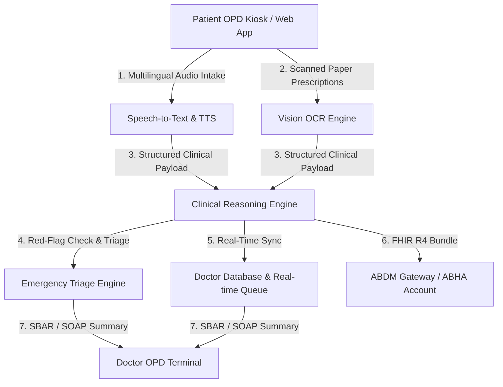

# SwasthaSetu (स्वास्थ्यसेतु) — Bridge to Healthcare

> **AI-Powered Pre-Consultation Clinical History, Multilingual Voice Intake & Medical OCR Bridge for Indian Healthcare**  
> _Aligned with the Ayushman Bharat Digital Mission (ABDM) & Digital Personal Data Protection (DPDP) Act 2023._

**Live Prototype (Hosted on Vercel)**: [https://swastha-setu-v4if.vercel.app/](https://swastha-setu-v4if.vercel.app/)  
**GitHub Repository**: [https://github.com/dearspartan/SwasthaSetu](https://github.com/dearspartan/SwasthaSetu)

---

## Executive Summary

In Indian tertiary government and private hospitals, outpatient department (OPD) doctors manage **up to 4,000+ patients daily**, limiting average consultation times to just **2–5 minutes per patient**. Up to **70–80% of clinical diagnoses** rely heavily on a detailed medical history, yet valuable doctor-patient time is routinely lost to manual scribing, language translation, and deciphering paper prescriptions.

**SwasthaSetu** bridges this critical gap. Operating via OPD hospital kiosks or patient smartphones, SwasthaSetu conducts an interactive **multilingual voice and touch clinical intake interview**, digitises paper health records using **Vision OCR**, flags life-threatening clinical red-flags (e.g., STEMI / Cardiac Risk), and delivers a **physician-ready structured clinical summary (SBAR/SOAP)** directly to the doctor's terminal before the patient enters the consultation room.

---

## Key Features & Capabilities

### 1. 8-Language Voice & Touch AI Intake Wizard

- **Multilingual Audio Intake & Speech Synthesis**: Hands-free voice speech-to-text (ASR) and text-to-speech (TTS) in **8 Indian languages** (_Hindi, Tamil, Telugu, Marathi, Bengali, Kannada, Malayalam, and English_).
- **SOCRATES Symptom Framework**: Structured history taking (Site, Onset, Character, Radiation, Associations, Timing, Exacerbating factors, Severity 1-10).
- **AYUSH Dashavidha Pariksha**: Dedicated Ayurvedic patient assessment covering Prakriti, Agni, Dhatu, and Vikriti profiling.

### 2. 3-Tier Vision OCR & Medical Document Guardrail

- **Tier 1 (Digital PDFs)**: Direct structured parameter extraction from lab reports and e-prescriptions.
- **Tier 2 (Scanned / Handwritten Copies)**: Deep vision extraction for physical paper records, discharge summaries, and lab values.
- **Tier 3 (Unreadable Data Guardrail)**: Automatic flagging of blurry/smudged details as `[UNREADABLE_DATA]` to prevent medical hallucination.
- **Non-Medical Document Rejection**: Intelligent vision guardrail that detects and rejects invalid files (electricity bills, receipts, ID cards) from entering the EHR.

### 3. Real-Time Red Flag Clinical Triage

- **Critical Alert Detection**: Instant identification of high-risk symptoms (e.g., STEMI chest pain, acute dyspnea, severe sepsis, neurological deficits).
- **Emergency Modal & ECG Order**: Prompts emergency triage alerts and orders emergency 12-lead ECG prior to routine OPD queueing.

### 4. Physician-Ready Summary Terminal (Doctor Workspace)

- **Live Queue Synchronization**: Real-time push of intake summaries from OPD kiosks to the attending physician's terminal via **Doctor Database & Real-Time Queue**.
- **SOAP & SBAR Formatting**: Standardized presentation including Chief Complaint, Timeline, History of Present Illness (HPI), Chronic Meds, OCR Extracted Labs, and Differential Diagnosis.

### 5. ABDM M1 & DPDP Act 2023 Compliance

- **ABHA Registration & Authentication**: Aadhaar-based OTP and ABHA ID verification (M1 Authentication).
- **Audio-Guided Consent**: Multilingual audio notice explaining data usage rights under the DPDP Act 2023.
- **HL7 FHIR R4 Bundle Export**: Standardized clinical artifact linking to the NHA ABDM Consent Manager network.

---

## Technical Approach & Architecture

### User Flow Diagram



### Layer & Technology Stack

| Layer                    | Technology                                     |
| :----------------------- | :--------------------------------------------- |
| **Speech-to-Text (ASR)** | Bhashini (Planned) + FasterWhisper (Active)    |
| **Text-to-Speech (TTS)** | Bhashini (Planned) + Piper (Active)            |
| **Conversational AI**    | LLaMA (SOCRATES & AYUSH Engine)                |
| **ABDM APIs**            | M1 authentication, HIP push, HIU pull          |
| **OCR Engine**           | PaddleOCR                                      |
| **Document AI**          | NER models trained on Indian medical documents |
| **Clinical Ontology**    | ICD-10 & SNOMED-CT Mapping                     |
| **Interoperability**     | HL7 FHIR R4 APIs                               |
| **Security**             | Trivy + HashiCorp Vault + GitLab               |
| **Frontend**             | Next.js + React + Tailwind CSS                 |
| **Backend**              | Fastify + Prisma ORM + Keycloak + NGINX        |
| **Database**             | MongoDB + PostgreSQL + Redis + MinIO           |

---

## Quick Start Guide

### Prerequisites

- **Node.js**: v18.0.0 or higher
- **npm**: v9.0.0 or higher
- **API Credentials**: Gemini API key / Database environment variables

### 1. Clone & Install Dependencies

```bash
git clone https://github.com/dearspartan/SwasthaSetu.git
cd SwasthaSetu
npm install
```

### 2. Environment Configuration

Create a `.env` file in the root directory:

```env
# Gemini API Key (Required for Multimodal Reasoning, OCR & Audio)
VITE_GEMINI_API_KEY=AIzaSy...

# Database & Queue Credentials (Required for Live Doctor Queue Sync)
VITE_SUPABASE_URL=https://drrrrmrasdmzpksxmxvu.supabase.co
VITE_SUPABASE_PUBLISHABLE_KEY=sb_publishable_sxEmFuoz7i1lZVWEe8krRg_bbcNTcHX
```

### 3. Run Development Server

```bash
npm run dev
```

Open [http://localhost:8080](http://localhost:8080) in your browser.

### 4. Build for Production

```bash
npm run build
```

---

## Core User Journeys

| Route          | Description                                                                                                                                                         |
| :------------- | :------------------------------------------------------------------------------------------------------------------------------------------------------------------ |
| **`/`**        | **Home Portal**: Overview of SwasthaSetu platform, ABDM integration, and OPD key statistics.                                                                        |
| **`/intake`**  | **Patient Intake Wizard**: 7-step guided interview (Consent -> Location -> Department -> Voice/Touch Interview -> Medical OCR -> AYUSH Intake -> Clinical Summary). |
| **`/doctor`**  | **Doctor Workspace Terminal**: Real-time OPD queue dashboard with detailed SBAR/SOAP patient profiles.                                                              |
| **`/patient`** | **Patient Health Passport**: Personal ABHA profile, linked prescriptions, chronic meds, and past visits.                                                            |
| **`/login`**   | **Portal Authentication**: ABHA ID + Aadhaar OTP login for patients and verified NMC/AYUSH registration login for doctors.                                          |

---

## License & Compliance Notice

Designed and built for Indian healthcare facilities under the guidelines of:

- **Ayushman Bharat Digital Mission (ABDM)** Health Data Management Policy.
- **Digital Personal Data Protection (DPDP) Act 2023**.
- **National Medical Commission (NMC)** Registered Healthcare Provider Standards.

---

_Built for Indian Healthcare._
